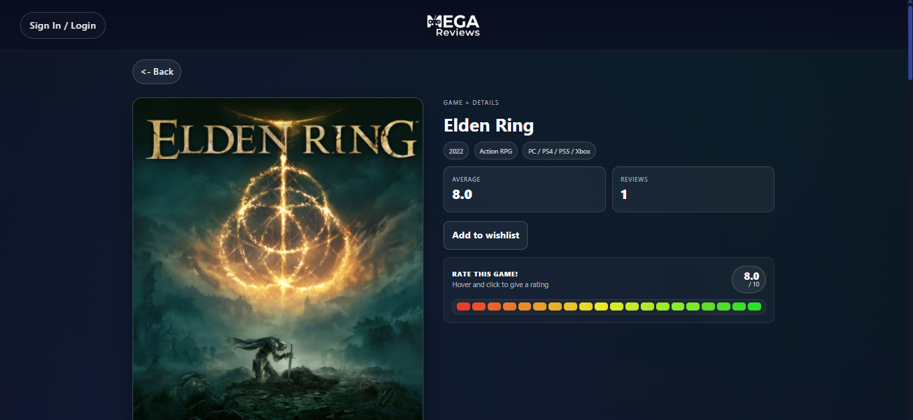
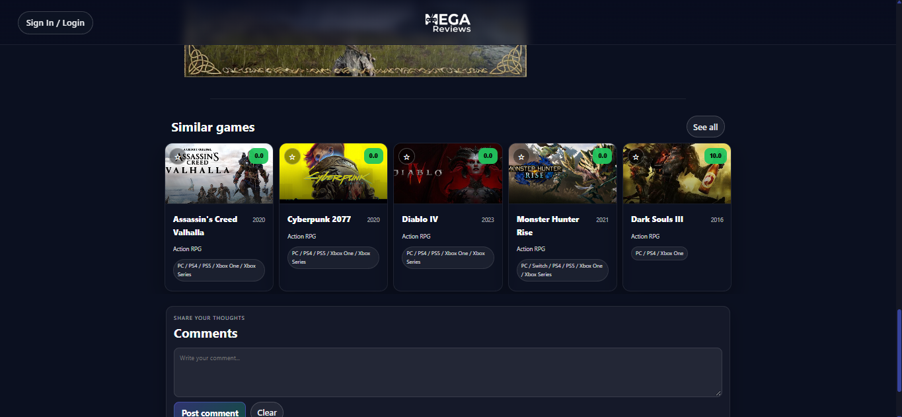

# MEGA Reviews

A full-stack web app for discovering, rating and tracking video games. Users browse a catalogue, rate games on a 0–10 scale, leave comments and keep a personal wishlist. Game covers and descriptions are pulled automatically from the Steam store.

> The live deployment is no longer online. The screenshots below show the app as it ran in production.


## Features

- **Games of the day**: a rotating carousel of random picks to start rating right away
- **Search and filters**: search by title or genre and filter by platform (PC, PS4, PS5, Switch, Xbox, Mobile)
- **Game pages**: cover, genre, platforms, release year, average rating and review count
- **Ratings**: interactive 0–10 rating bar, with averages computed in the database
- **Comments**: users can share their thoughts on each game
- **Similar games**: recommendations based on genre
- **Wishlist**: save games to a personal list
- **Authentication**: sign up and log in, with protected routes and logout
- **Admin tools**: admins can add and remove games and upload cover images
- **Steam metadata**: covers and descriptions fetched from the Steam store API and cached for 12 hours

## Screenshots

| Game details | Similar games and comments |
|---|---|
|  |  |

## Tech stack

| Layer | Technologies |
|---|---|
| Frontend | React 19, TypeScript, Vite, React Router, CSS Modules |
| Backend | Node.js, Express, TypeScript |
| Database | PostgreSQL (hosted on Neon) |
| Auth | JWT with bcrypt password hashing, Firebase Authentication |
| Storage | Cloudinary (cover uploads via Multer) |
| External APIs | Steam Store API |
| Deployment | Vercel (frontend) |

## Architecture

```
game-reviews/
├── frontend/          # React SPA
│   └── src/
│       ├── components/   # GameCard, RatingBar, GameSearch, modals…
│       ├── pages/        # Home, GameDetails, Wishlist, AddGame, SignIn
│       ├── state/        # Auth and wishlist context
│       └── lib/          # API client, Firebase, env config
└── backend/           # REST API
    └── src/
        ├── routes/       # auth, users, games, reviews, wishlist, uploads
        ├── controllers/
        ├── models/       # SQL queries for Game, Review, User, Wishlist
        ├── middleware/   # Auth, role checks, centralised error handler
        └── services/     # Steam cover and description lookup
```

The frontend talks to the API over REST. Protected routes require an `Authorization: Bearer <token>` header, and admin-only routes (adding games, uploading covers) are guarded by role middleware.

## API overview

| Method | Endpoint | Description |
|---|---|---|
| `POST` | `/api/auth/register` | Create an account |
| `POST` | `/api/auth/login` | Log in and receive a JWT |
| `GET` | `/api/users/me` | Current user's profile |
| `GET` | `/api/games` | List games (also `/top`, `/random`, `/:id`) |
| `POST` | `/api/games` | Add a game (admin) |
| `DELETE` | `/api/games/:id` | Remove a game (admin) |
| `GET` | `/api/reviews/game/:gameId` | Reviews for a game |
| `POST` | `/api/reviews` | Rate or review a game |
| `DELETE` | `/api/reviews/:id` | Delete your own review |
| `GET` | `/api/wishlist` | Your wishlist |
| `POST` / `DELETE` | `/api/wishlist` / `/api/wishlist/:gameId` | Manage your wishlist |
| `POST` | `/api/uploads/cover` | Upload a cover image (admin) |

## Running locally

**Requirements:** Node.js 18+, a PostgreSQL database, a Firebase project and a Cloudinary account.

### Backend

```bash
cd backend
npm install
```

Create `backend/neon.env` with:

```env
PGHOST=<host>
PGDATABASE=<database>
PGUSER=<user>
PGPASSWORD=<password>
PGSSLMODE=require
JWT_SECRET=<strong secret>
JWT_EXPIRES_IN=12h
CLOUDINARY_URL=cloudinary://<key>:<secret>@<cloud>
FIREBASE_PROJECT_ID=<project id>
FIREBASE_CLIENT_EMAIL=<service account email>
FIREBASE_PRIVATE_KEY="<service account private key>"
STEAM_USER_AGENT="Mozilla/5.0 (GameReviewsBot/1.0)"
```

```bash
npm run dev     # development server on http://localhost:3000
```

### Frontend

```bash
cd frontend
npm install
cp .env.example .env    # set VITE_API_URL and VITE_ASSETS_BASE_URL if needed
npm run dev
```

## Author

Gabriel Corvo ([@karaasu13](https://github.com/karaasu13))
